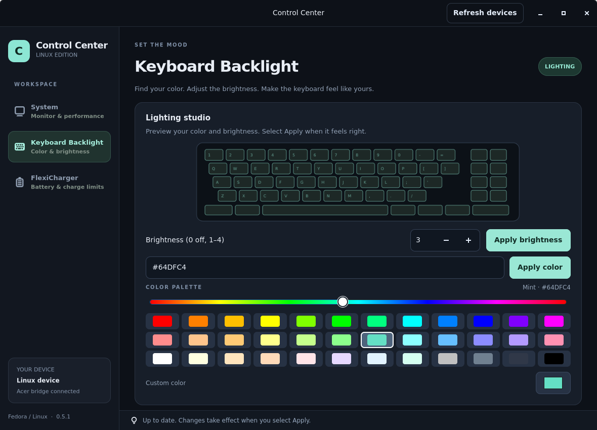
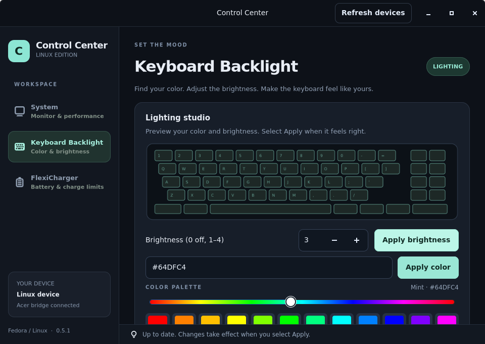

# Acer ALG Control Center for Fedora

**Your laptop controls, together in one place.**

A native Linux application for monitoring and controlling the supported Acer
Aspire Lite AL15G-52 on Fedora.

**Current version: 0.5.1** · [Get started](#easy-installation-guide) ·
[Check compatibility](#compatibility) · [Troubleshooting](#troubleshooting)



*Preview with simulated device data. The selected keyboard color is a preview
until you click Apply.*

<details>
<summary>See the compact window preview</summary>



</details>

## What you can do

- **System:** view device readings and manage supported fan and performance controls.
- **Keyboard Backlight:** choose from 36 colors, use the hue slider or a custom RGB color, and adjust brightness.
- **FlexiCharger:** view the battery level and set available charging limits.

Controls depend on the interfaces detected on your machine. See the
[compatibility details](#compatibility) before installing.

## Release 0.5.1

This repository contains the **0.5.1** Linux source release. It includes the
GTK application, Fedora setup scripts, and the source for the model-specific
driver. The driver is built locally for your running kernel during setup.
Version 0.5.1 adds the expanded keyboard color palette and custom color picker.
See the [release notes](RELEASE_NOTES.md) for details.

To get the files, use **Code → Download ZIP** on GitHub and follow the
[installation guide](#easy-installation-guide) below.

**Read the compatibility table before installing.** The Acer ALG name covers
multiple hardware configurations. A matching product name by itself does not
mean this firmware driver is suitable for another laptop.

## Easy installation guide

These steps are for a fresh installation on the supported laptop running a
regular Fedora desktop. You need an internet connection and a Fedora account
that can install software. Keep your laptop plugged in during setup.

### 1. Open Terminal

Click **Activities** or open the applications list, search for **Terminal**,
and open it. Copy each command below, paste it into Terminal with
**Ctrl+Shift+V**, and press **Enter**. You can also right-click and choose
**Paste**. Commands only run after you press Enter.

When Terminal asks for your password, type your normal Fedora login password
and press Enter. **Nothing appears while you type**; this is normal. If asked
whether to install packages, type `y` and press Enter.

### 2. Check your laptop

Copy and run these three lines:

```bash
cat /sys/class/dmi/id/sys_vendor
cat /sys/class/dmi/id/product_name
cat /sys/class/dmi/id/bios_version
```

The answers must be **Acer**, **Aspire Lite AL15G-52**, and **1.07.01RAC2**,
in that order. If one is different or a command shows an error, **stop here**
and ask for help. Don't change your BIOS or bypass the checks to make it fit.
See the compatibility table below for other requirements and the tested setup.

### 3. Download the files

On the GitHub repository page, click **Code → Download ZIP**. Open your
Downloads folder, right-click the ZIP, and choose **Extract** or **Extract
Here**. Open the extracted folder and find the folder named
**ControlCenterLinux**. Leave it there for future updates.

### 4. Check Secure Boot

In Terminal, run these lines:

```bash
sudo dnf install mokutil
mokutil --sb-state
```

- If the result says **SecureBoot disabled**, go to step 5.
- If it says **SecureBoot enabled**, first follow [Secure Boot: first-time key
  setup](#secure-boot-first-time-key-setup), then return to step 5 after the
  laptop restarts. This gives the laptop a key it can trust for the driver.
- If you see an error or aren't sure which result you got, stop and ask for
  help. Do not guess or change your BIOS security settings.

### 5. Install the app

Open the **ControlCenterLinux** folder in the Files app. Right-click an empty
area and choose **Open in Terminal**. If you don't see that option, open Terminal,
type `cd` followed by a space, drag the **ControlCenterLinux** folder into the
Terminal window, then press Enter. The folder's path will be filled in for you.

Copy and run:

```bash
bash setup-fedora.sh
```

If you enrolled a key stored somewhere other than the default paths, run the
custom-key command in the Secure Boot section instead, using your actual paths.

Enter your password and approve package installation when prompted. Wait until
you see **Setup complete**. The process can take several minutes and requires
internet access. If you see **Setup stopped** or an error instead, see
[Troubleshooting](#troubleshooting); opening the app alone does not confirm
that its driver installed successfully.

### 6. Open and check the app

Open the applications list and search for **Control Center Clone**, or run:

```bash
control-center-clone
```

Check that system readings appear. To try a fan control, briefly select
**Maximum** and click **Apply**, then select **Automatic** and click **Apply**
again. Try a keyboard color and check the battery limit readback. Controls may
vary depending on what your machine reports. If a control is missing or doesn't
work, see [Troubleshooting](#troubleshooting).

### 7. After a Fedora kernel update

Keep the extracted files. After Fedora starts using a new kernel, open Terminal
in the same **ControlCenterLinux** folder again and run:

```bash
bash setup-fedora.sh
```

This rebuilds the driver for the running kernel. If you used a signing key in
a custom location, use the custom-key command in the Secure Boot section again.
You normally don't need to create or enroll the same key again.

## Compatibility

| Item | What this release supports or requires |
| --- | --- |
| Application release | Linux **0.5.1**. This is separate from the laptop's BIOS, Fedora, and Linux kernel versions. |
| Manufacturer and product | DMI vendor `Acer`, product `Aspire Lite AL15G-52`, exactly as reported by Fedora. |
| BIOS | Exactly `1.07.01RAC2`. A newer or older BIOS is not verified, even on the same model. |
| Firmware and hardware | ACPI device `CLV0001`, with the expected two fans and keyboard type 6. The app checks the reported hardware identity when detecting firmware controls. |
| Operating system | A regular, DNF-based Fedora desktop running directly on the laptop. Windows, WSL, virtual machines, other Linux distributions and immutable Fedora variants are not covered by these instructions. |
| Tested environment | A native Fedora 44 installation with kernel `7.1.8-200.fc44` was used for the firmware probe; the owner reports working controls. This is evidence from one laptop, not a guarantee for every matching machine or kernel. |
| Other Fedora or kernel versions | Not established as compatible. Setup attempts to build against the **running** kernel and requires its matching `kernel-devel` package. A successful build alone does not verify hardware behavior. |

The setup script checks the exact DMI model and BIOS and stops if they differ;
the driver also matches the model, BIOS and ACPI device. **Do not edit or
bypass these checks to force installation on an unverified system.** A BIOS
update can make a previously supported laptop fail these checks.

Check your model and BIOS in a Fedora terminal:

```bash
cat /sys/class/dmi/id/sys_vendor
cat /sys/class/dmi/id/product_name
cat /sys/class/dmi/id/bios_version
```

The expected output is `Acer`, `Aspire Lite AL15G-52`, and `1.07.01RAC2`,
respectively. Also identify your Fedora and running kernel versions:

```bash
cat /etc/fedora-release
uname -r
```

If any model or BIOS value differs, stop and request support for that exact
system before installing. If the values match, still check the OS, kernel, and
hardware requirements above; a match alone doesn't guarantee all controls work.
Never downgrade or change your BIOS merely to meet this check.

## Installation details

You need internet access, a Fedora desktop account with sudo access, and the
source files from this repository. Download and extract the repository ZIP, or
clone it with Git. Open a terminal in the extracted repository folder, then:

```bash
cd ControlCenterLinux
bash setup-fedora.sh
```

Run setup as your **normal user**, not as root. It requests your password when
needed, installs the GTK application and dependencies, builds the driver for the
running kernel, and configures it to load at boot. It does not apply fan,
lighting, or charging settings during installation. Setup writes a log to
`ControlCenterLinux/setup-fedora.log`.

Launch **Control Center Clone** from Applications, or run:

```bash
control-center-clone
```

If Secure Boot is enabled, setup needs a signing key that is already enrolled
on that laptop. Follow the next section before running or rerunning setup.
If setup reports a missing matching `kernel-devel` package, resolve that Fedora
package issue for the running kernel before retrying; do not use a module built
for a different kernel.

## Secure Boot: first-time key setup

Check the status:

```bash
sudo dnf install mokutil
mokutil --sb-state
```

If Secure Boot is disabled, no key setup is normally needed. If it is enabled
and you already have an enrolled module-signing key, use it with setup:

```bash
CC_MODULE_KEY=/path/to/key.priv CC_MODULE_CERT=/path/to/certificate.der bash setup-fedora.sh
```

If you don't have a key, create and enroll a new one on this laptop. These
commands create the paths expected by setup; do not run them if those files
already exist, since that would replace your existing key. If you aren't sure
whether you have a key already, ask for help before creating another one.
Check the default file paths first:

```bash
sudo ls -l /etc/pki/mok/ControlCenterLinux.priv /etc/pki/mok/ControlCenterLinux.der
```

If either file exists, use your existing key or choose different paths and
pass those paths to setup as shown above; ask for help if you don't know which
key is enrolled. If both lines say **No such file or directory**, and you know
you don't already have an enrolled key, run the following commands in order.
Wait for each command to finish; if any reports an error, stop and ask for help.

```bash
sudo dnf install openssl mokutil
sudo install -d -m 0700 /etc/pki/mok
sudo openssl req -new -x509 -newkey rsa:2048 \
  -keyout /etc/pki/mok/ControlCenterLinux.priv \
  -outform DER -out /etc/pki/mok/ControlCenterLinux.der \
  -nodes -days 3650 -subj '/CN=ControlCenterLinux/'
sudo chmod 600 /etc/pki/mok/ControlCenterLinux.priv
sudo mokutil --import /etc/pki/mok/ControlCenterLinux.der
```

The last command asks you to choose and confirm a temporary enrollment
password. Write it down for the next step. Restart the laptop. Before Fedora
starts, a blue MOK management screen should appear: choose **Enroll MOK →
Continue → Yes**, enter that password, and choose **Reboot**. If the screen
doesn't appear or you cannot complete enrollment, stop and ask for help.

After Fedora starts, return to [step 5](#5-install-the-app) and reopen Terminal
in the `ControlCenterLinux` folder. Keep the private
key protected: it can sign kernel modules trusted by this machine. Setup does
not generate keys, enroll them, or change Secure Boot settings itself. See
[Red Hat's module signing guide](https://docs.redhat.com/en/documentation/red_hat_enterprise_linux/10/html/managing_monitoring_and_updating_the_kernel/signing-a-kernel-and-modules-for-secure-boot)
for background on signing and MOK enrollment.

## Verify and maintain

After setup, open the app and check telemetry. Test Maximum fan mode briefly,
then return to Automatic; check keyboard lighting and charging readback. Use
**Apply** to commit changes. Available controls depend on hardware detection.

After booting a new kernel, run `bash setup-fedora.sh` again from the same
folder to rebuild and sign the module for that kernel. The rebuild is not
automatic. Keep the source folder and your signing key for future updates.

## Troubleshooting

If setup fails, open the extracted **ControlCenterLinux** folder in Files and
open **setup-fedora.log** with a text editor. The last lines normally identify
the step that failed. If you don't see a log, note the error shown in Terminal;
some checks happen before the log is created. A desktop app may
be installed even if a later driver step failed; firmware controls require a
successfully loaded driver. For a support request, include the model and BIOS
outputs above, Fedora release, `uname -r`, Secure Boot status, the failed step
and relevant log output. Do not share the private signing key. To collect a
read-only diagnostic from the `ControlCenterLinux` folder:

```bash
python3 main.py --diagnose --output control-center-fedora-diagnostics.json
```

Review diagnostic files before sharing them, as they can contain details about
your system. See the [application README](ControlCenterLinux/README.md) and
[driver documentation](ControlCenterLinux/driver/README.md) for further details.
Use this root README for the current release's installation instructions.

## Licensing

The driver source files carry `GPL-2.0-only` SPDX identifiers. A license for
the remaining project files has not yet been specified; consult the project
owner before redistributing or reusing them.
